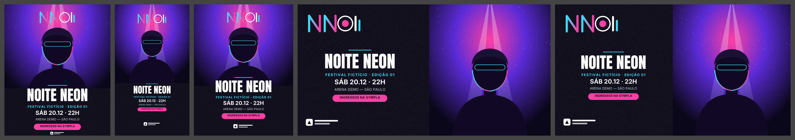

# Demonstração — Noite Neon (evento FICTÍCIO)

> Todos os arquivos são sintéticos (gerados por código): não há pessoas, marcas, locais ou artistas reais.
> Fontes: Anton e Inter (SIL Open Font License).



| Peça | Dimensão | Proporção | Estado | SHA-256 do PNG | Decisões do motor de adaptação |
|---|---|---|---|---|---|
| Layout principal (aprovado) | 1080 × 1350 | 4:5 | Aprovado | `5342e7720204500a…` | — |
| Story | 1080 × 1920 | 9:16 | Verificações aprovadas · aguardando revisão humana | `0569de02f9c4874d…` | Artista (fictício): preenchimento com recorte proporcional em 1080×1152<br>Zona Marca: escala 1.155<br>Zona Informações: escala 0.875<br>Zona Patrocínio: escala 1.680 |
| Feed | 1080 × 1440 | 3:4 | Verificações aprovadas · aguardando revisão humana | `89a14d0b915d4bf7…` | Artista (fictício): preenchimento com recorte proporcional em 1080×893<br>Zona Marca: escala 0.984<br>Zona Informações: escala 0.992<br>Zona Patrocínio: escala 1.523 |
| Sympla | 1600 × 838 | ≈1,91:1 | Verificações aprovadas · aguardando revisão humana | `9f86997b96eeeee0…` | Artista (fictício): preenchimento com recorte proporcional em 768×838<br>Zona Marca: escala 0.927<br>Zona Informações: escala 0.721<br>Zona Patrocínio: escala 1.484 |
| Telão | 1920 × 1080 | 16:9 | Verificações aprovadas · aguardando revisão humana | `c3a017657d406cc7…` | Artista (fictício): preenchimento com recorte proporcional em 960×1080<br>Zona Marca: escala 1.190<br>Zona Informações: escala 0.859<br>Zona Patrocínio: escala 1.904 |

## Como foi produzido
1. Layout principal 1080×1350 montado só com arquivos originais (foto, 2 logos, textura, 3 fontes), cada um identificado por SHA-256.
2. Aprovação → contrato de identidade congelado (recursos protegidos, textos obrigatórios, fontes, regras por proporção).
3. Adaptação **por regras** (zonas reposicionadas com escala uniforme; foto preenche a área com recorte proporcional, sem distorção).
4. Renderização determinística (graphics-core/0.2.0+resvg-2.6.2) e 10 verificações automáticas por formato — nenhuma falha.
5. Nada foi aprovado automaticamente: as adaptações aguardam revisão humana.

## Comparação entre os formatos
- **Story (9:16)**: empilhado; foto ocupa 60% superior; bloco de informações ocupa a largura útil (margem de 120 px por causa da interface do Instagram).
- **Feed (3:4)**: o mais próximo do principal; escalas ≈ 1,0.
- **Sympla (≈1,91:1)**: lado a lado — informações à esquerda, foto à direita; texto reduzido (0,72) para caber na altura útil.
- **Telão (16:9)**: lado a lado com mais respiro; título maior que no Sympla.

## Reproduzir
```bash
cd studio-ai && npm run export:demo -- ./demo/noite-neon
```
O mesmo comando gera os mesmos bytes (renderização determinística); `relatorio.json` traz o contrato e o relatório de qualidade de cada formato.
